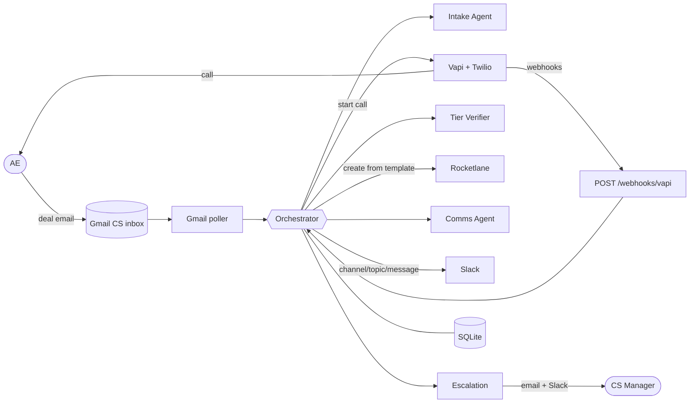

# Architecture — NovaCRM Onboarding Agents

Canonical engineering reference. The visual version is `architecture.html`; when they disagree, this file wins. Standards: `engineering-standards.md`. Pending decisions: `open-questions.md`.

## 1. Scope

**In scope:** Gmail-triggered intake, a voice call to confirm the tier, a Rocketlane project from the tier's template, a personalized Slack channel, the Rocketlane overdue automation (UI config), guardrails, audit log + traces, tests, and two demo videos.

**Out of scope:**
- Kickoff scheduling.
- The handoff summary (stretch goal).
- Asana migration or backfilling existing customers.
- Moving the customer's data. That's human work *inside* the Data Migration phase; we create, track and gate those tasks.
- Reading Salesforce.
- Real Slack Connect (mocked).

## 2. Design decisions (pain point → fix)

| Pain point | Root cause | Decision |
|---|---|---|
| Template mix-ups | Tier not in the email; template picked by hand | Tier confirmed on the call with a read-back plus a transcript check; template picked in code from `templates.yaml` |
| Data marked migrated but not verified | "Done" is one click | Customer-approval task gates the Data Migration phase (pending Q6) |
| Escalations fall through | Depends on memory | Rocketlane automation: overdue 1d → PM, 4d → Owner |
| Manual project creation | Unstructured email handoff | Gmail watcher + Intake Agent with strict validation |
| Manual Slack setup | Repetitive, inconsistent | Communication Agent writes the copy, code creates the channel |
| Dedicated vs pooled CSM | Rules live in people's heads | Routing config per tier (pending Q2) |

## 3. Principles

1. Deterministic state machine as the spine; LLMs only for judgment (parse, verify, write).
2. Agents propose (typed output); code validates and executes. Agents have no side-effect tools.
3. Ports & adapters: real adapters for the demo, fakes for tests.
4. Idempotent by default (Gmail message id as the natural key; marker check before retrying a create).
5. Fail to a human, never to a guess.
6. The voice call is async (webhook), so the workflow is split around it with state in the DB.

## 4. System context



## 5. Deal state machine

```
RECEIVED ──► IGNORED                (not a deal / sender not allowed)
RECEIVED ──► NEEDS_INFO ──► RECEIVED (AE replies)  | ──► ESCALATED (48h)
RECEIVED ──► AWAITING_TIER ──► CALLING
CALLING  ──► TIER_CONFIRMED | CALL_RETRY_WAIT ──► CALLING | ESCALATED
TIER_CONFIRMED ──► DUPLICATE_HOLD ──► ESCALATED
TIER_CONFIRMED ──► RL_RETRY_WAIT ──► TIER_CONFIRMED | ESCALATED
TIER_CONFIRMED ──► PROJECT_CREATED ──► COMPLETED | PARTIAL ──► ESCALATED
ESCALATED ──► (human resolve) ──► AWAITING_TIER / TIER_CONFIRMED
```

Transitions only through `transition()`, which checks `ALLOWED`, uses optimistic locking (`version`), and writes the audit row in the same transaction.

## 6. Components

### Intake & Routing Agent
1. Sender allowlist (code).
2. LLM parse into `DealIntake` (with an `evidence` quote per field; `null` if absent, never inferred).
3. Grounding check: each evidence quote must appear verbatim in the email, otherwise the field counts as missing.
4. Validation: required fields, email syntax, Salesforce opportunity URL pattern.
5. Enrichment: AE phone from `ae_directory.yaml`.
6. Missing data → reply on the thread, `NEEDS_INFO`. A reply re-parses the whole thread.
7. Routing after the tier is confirmed: `route(tier) → template_id, duration_days, csm, owner` (pure, from config).

Required fields: `customer_company`, `contact_name`, `contact_email`, `ae_name`, `ae_email`, `ae_phone` (directory), `sf_opportunity_url`. Optional: `close_date`, `deal_value`, `notes`.

### Voice call (Vapi)
- The assistant is created by `scripts/setup_vapi_assistant.py`. It has a server tool `record_plan_tier(tier: enterprise|growth|unclear, ae_confirmed: bool, ae_quote: str)` and its server URL points to `/webhooks/vapi` (shared secret).
- Script: confirm identity → ask for the tier → re-ask once if unclear → read back → explicit yes → record.
- **Two-key confirmation:** the tool call must say confirmed, **and** the Tier Verifier agent must reach the same tier from the full transcript. Any mismatch counts as unclear.
- Outcomes: CONFIRMED / NO_ANSWER (did-not-answer, busy, voicemail) / UNCLEAR / CALL_ERROR.

### Rocketlane
- ⚠️ Verify against the API docs with a real key before building on it. Working assumption: base `https://api.rocketlane.com/api/1.0`, header `api-key`, `POST /projects` accepts a template source. Fallback: create the project, then phases and tasks from config.
- Two templates (Enterprise 30d, Growth 14d), 4 phases, 15 tasks (pending Q3). Proposed task list:
  - Kickoff: review handoff, kickoff call, success criteria & plan.
  - Data Migration: collect export, field mapping sign-off, sandbox import, **customer verifies migrated data**, production import.
  - Configuration: workspace & users, pipelines & fields, integrations, admin training.
  - Go-Live: UAT sign-off, go-live, handoff to support.
- The project carries an `Intake deal id` field as the idempotency marker.
- Duplicate check: our marker first, then the normalized customer name among active projects → `DUPLICATE_HOLD`.
- The overdue automation is configured in the UI: overdue 1d → Project Manager; overdue 4d → Project Owner.

### Communication Agent + Slack
- The agent returns `SlackChannelPlan(channel_name, topic, welcome_message)`. The tone is tier-specific: Enterprise introduces the dedicated CSM with a 30-day timeline; Growth introduces the onboarding pod with a 14-day fast track.
- Code validates the plan: name matches `^[a-z0-9][a-z0-9-_]{0,79}$` and contains the customer slug; the message mentions the customer, tier and CSM; ≤ 3000 chars. One regenerate, then fall back to a fixed template.
- Calls: `conversations.create` → `setTopic` → `chat.postMessage` → invite the internal CSM → `inviteShared` **mocked** (logged and audited).

### Escalation
`escalate(deal, reason, evidence)` sends an email and a `#cs-escalations` post with what happened, what was tried, and how to resolve it. A human resolves through `POST /deals/{id}/resolve` (actor and reason are required and audited).

## 7. Retry policy

| Operation | Retry on | In-request | Scheduled | Exhausted |
|---|---|---|---|---|
| Gmail poll | network/5xx/429 | — (next tick) | backoff to 5m | `/health` degraded |
| Gmail send | 5xx/429/timeout | 3× exp | — | logged; Slack still notified |
| LLM call | 5xx/429/timeout | SDK + 2 | — | intake → ESCALATED; comms → fixed template |
| LLM invalid output | schema/grounding fail | 1 re-ask with error | — | NEEDS_INFO |
| Vapi start call | 5xx/timeout | 3× exp | counts as an attempt | — |
| Voice attempt | not CONFIRMED | 1 re-ask in call | T+0, +10m, +30m (demo 1m), business hours | ESCALATED |
| Rocketlane | 5xx/429/timeout | 3× exp (1/2/4s) | +1m, +5m, +15m | ESCALATED (4xx: immediately) |
| Slack | 5xx/429 | 3× exp | +1m, +5m | PARTIAL → ESCALATED |
| AE clarification | no reply | — | reminder +24h | ESCALATED +48h |

Timeouts are not failures: search for our marker before retrying any create. Webhooks dedupe on `(call_id, type)`. Jobs persist in SQLite; a startup sweep re-queues stranded deals.

## 8. Guardrails

| # | Guardrail | Source |
|---|---|---|
| G1 | Required fields, else ask the AE | Spec |
| G2 | No project without a confirmed tier (enforced by the state machine) | Spec |
| G3 | Audit log: timestamp, input, output, rationale | Spec |
| G4 | Grounding: extracted fields must quote the email | Ours |
| G5 | Two-key tier confirmation | Ours |
| G6 | Sender allowlist | Ours |
| G7 | Idempotency + duplicate-project hold | Ours |
| G8 | Agents have no side-effect tools; email treated as untrusted | Ours |
| G9 | Bounded retries with backoff | Ours |
| G10 | Slack output validation | Ours |
| G11 | Business-hours calls + identity check | Ours |
| G12 | Data-migration verification gate | Pending Q6 |
| G13 | Webhook + admin auth, secrets from env | Ours |

## 9. Data model

- `deals`: id, gmail_message_id (unique), gmail_thread_id, status, version, customer/AE fields, plan_tier, tier_source (voice | human_override), rocketlane_project_id, slack_channel_id, timestamps.
- `call_attempts`: deal_id, attempt_no, vapi_call_id, ended_reason, tool_tier, verifier_tier, outcome, transcript, recording_url, times.
- `audit_log`: ts, deal_id, actor, action, input_json, output_json, rationale, status, latency_ms, trace_id. Append-only.
- `agent_traces` / `agent_spans`: local copy of Agents SDK traces (group_id = deal id).
- `webhook_events`: (call_id, type) unique, for dedupe.
- `routing_state`: round-robin cursor per tier.
- APScheduler job store tables.

## 10. API

| Method | Path | Auth | Purpose |
|---|---|---|---|
| GET | `/health` | none | Gmail token, DB, last poll |
| POST | `/webhooks/vapi` | shared secret | tool-calls, status-update, end-of-call-report |
| POST | `/admin/poll` | admin token | force a poll |
| GET | `/deals`, `/deals/{id}` | admin token | state |
| GET | `/deals/{id}/audit` | admin token | decision timeline |
| GET | `/deals/{id}/traces` | admin token | agent traces |
| POST | `/deals/{id}/resolve` | admin token | human override (actor + reason) |
| POST | `/deals/{id}/retry` | admin token | re-run from current state |

No custom UI. The demo uses Gmail, the phone, Rocketlane, Slack, terminal logs, FastAPI `/docs` and OpenAI Traces.

## 11. Observability

- Audit log answers **which step failed and why**. Traces answer **what the agent saw and returned**.
- Traces go to OpenAI Traces and the local `SQLiteTraceProcessor`. One trace per workflow step (`intake`, `voice_call`, `project_creation`, `communication`, `escalation`), all with `group_id = deal_id`. Non-LLM steps go in `custom_span`s.
- Debug order: `/deals/{id}` → `/audit` → `/traces` → Vapi dashboard (recording).

## 12. Testing (Part 4 mapping)

| Area | Tests |
|---|---|
| Happy path | `test_enterprise_deal_end_to_end` |
| Validation | missing name / contact email / bad email / malformed / ungrounded field |
| Template accuracy | `test_tier_routing[enterprise\|growth]` |
| Edge cases | Rocketlane 503 → escalate; duplicate → hold; no answer → retries → escalate; unclear / verifier mismatch / unknown plan |
| Extra | idempotent reprocess, prompt injection, human override audited, token refresh failure, webhook auth, concurrent transition |

## 13. Demo vs production

| Area | Demo | Production |
|---|---|---|
| Trigger | Gmail polling | Gmail watch → Pub/Sub, with polling as a backstop |
| Tier source | Voice call | Salesforce primary, call to confirm |
| Slack | Internal channel, mocked Slack Connect | Real Slack Connect |
| Storage/jobs | SQLite + APScheduler | Postgres + Alembic, durable queue / Temporal |
| Hosting | Laptop + ngrok | Cloud Run/ECS, secrets manager |
| Auth | Shared secrets | SSO, signed webhooks, least-privilege keys |
| Existing customers | Not imported | Idempotent backfill script with dry-run |
| Observability | Audit + traces + console | Dashboards, stuck-state alerts, PII redaction, retention |

## 14. Implementation phases

| Phase | Work | Depends on |
|---|---|---|
| P0 | Accounts & spikes (user): OpenAI, Gmail + GCP OAuth, Twilio, Vapi, ngrok, Slack, Rocketlane | — |
| P1 | Skeleton: config, models, db, state machine, audit, logging, tracing, main | — |
| P2 | Ports + fakes + conftest | P1 |
| P3 | Gmail connector + poller + `handle_inbound` | P2 |
| P4 | Vapi assistant script, `start_call`, webhook, tier verifier, retries | P2 |
| P5 | Notifier + escalation | P3 |
| P6 | Intake agent + validation + clarification loop | Q1 |
| P7 | Rocketlane templates, adapter, routing, dedupe | access, Q2, Q3 |
| P8 | Comms agent + Slack | P7 |
| P9 | Rocketlane automation (UI) | access |
| P10 | Admin API + resume sweep | P5 |
| P11 | Full test suite | all |
| P12 | README, Part 1 doc, videos | all |

Each phase has a "done when" check. See `architecture.html#impl` for the detailed file and function list.
