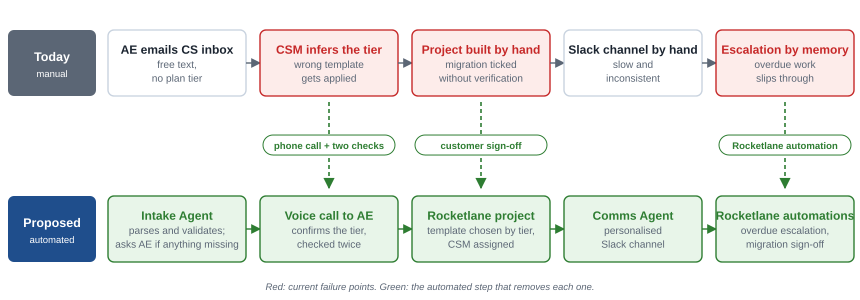
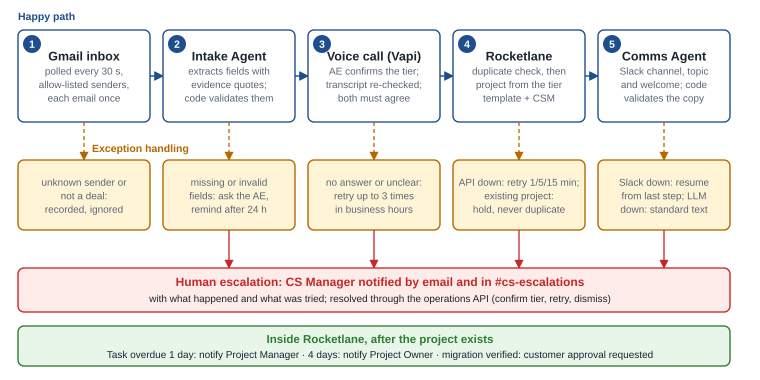
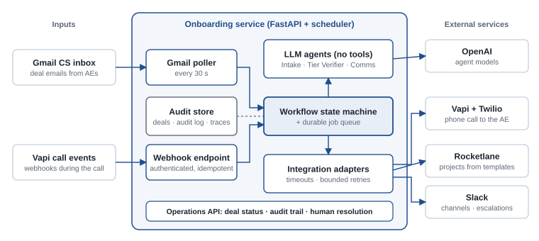

# Customer Onboarding Automation: Requirements & Workflow Analysis

| | |
|---|---|
| **Client** | NovaCRM, Customer Success |
| **Prepared for** | Rocketlane: Forward Deployed Engineer assessment, Part 1 |
| **Prepared by** | Karthick Sriram · 29 October 2026 · v1.0 |
| **Status** | Final. Design decisions confirmed with Karthik Ramaiah (Rocketlane) on 29 Oct 2026 |

## 1. Executive summary

NovaCRM's Customer Success team onboards every new customer by hand. When a deal closes, the Account Executive (AE) emails the CS inbox; a CSM then creates a project from a template, opens a Slack channel, and tracks fifteen tasks across four phases. The process fails in three recurring ways: the **wrong template** is applied because the email doesn't state the plan tier; **data migration is marked done** without the customer verifying it; and **stalled work isn't escalated** because escalation depends on memory.

The proposed system automates the handoff from closed deal to running onboarding project. An Intake Agent reads and validates the email, a voice agent calls the AE to confirm the tier, the system creates the Rocketlane project from the correct template, and a Communication Agent opens a personalised Slack channel. Rocketlane automations then handle overdue escalation and the customer's migration sign-off.

**Guiding principle:** deterministic code controls the workflow. Language models only read and write text, and never decide whether anything is created. When data is missing or uncertain, the system asks a person instead of guessing.

## 2. Current workflow and root causes

Today the AE's email is the only input: unstructured text with the customer name and Salesforce link. Everything after it (choosing the template, building the project, opening the channel, chasing tasks, escalating) is manual.

| Problem | Root cause | Remedy |
|---|---|---|
| Wrong template applied | The tier isn't in the email, so the CSM infers it | Tier **confirmed by phone with a read-back**, checked a second time against the transcript, then **mapped to a template by configuration**. No default tier exists. |
| Migration closed unverified | Completing the task is one click, with no customer step | "Customer verifies migrated data" is assigned to the customer and **requests their approval** in Rocketlane when completed |
| Escalations missed | Nothing enforces them | **Rocketlane automation**: 1 day overdue → Project Manager; 4 days → Project Owner |
| Slow, inconsistent set-up | Manual copying from email into tools | Fields extracted **with supporting quotes** and validated by code; channel and copy generated per tier |

**In scope:** Gmail intake, voice confirmation, Rocketlane project creation and CSM assignment, the Slack channel, both Rocketlane automations, guardrails, audit trail, automated tests. **Deferred** (§7): kickoff scheduling, the handoff summary, blocked-task escalation, Salesforce, migrating existing Asana projects.

## 3. Proposed agentic workflow

| Component | Type | Does | Never does |
|---|---|---|---|
| **Intake & Routing Agent** | LLM (OpenAI Agents SDK), no tools | Extracts customer, contact name and email, AE name and Salesforce link, each with a verbatim quote from the email | Infers the tier, invents a value, or triggers an action |
| **Voice agent** | Vapi assistant on a Twilio number | Calls the AE, asks Enterprise or Growth, reads back customer and tier, records the confirmed answer | Decides anything; it only records what the AE said |
| **Tier Verifier** | LLM, no tools | Re-reads the call transcript independently; its answer must match the voice agent's | Overrides the call; any disagreement counts as unclear |
| **Orchestrator** | Deterministic state machine | Makes every external call: the phone call, the Rocketlane project, the Slack channel, escalations | Acts on anything that hasn't passed validation |
| **Communication Agent** | LLM, no tools | Writes the channel topic and welcome message from verified facts only | Posts anything code hasn't checked; if it fails, a standard message is used |
| **Overdue escalation** | Rocketlane automation | Notifies the Project Manager at 1 day overdue and the Project Owner at 4 days | Nothing in code: it is configured in Rocketlane |

**Template routing** is fixed configuration: **Enterprise** → *Enterprise Onboarding (30d)* with a **dedicated CSM** assigned round-robin; **Growth** → *Growth Onboarding (14d)* with the **pooled** onboarding team. Both templates share the same fifteen tasks in four phases (Kickoff, Data Migration, Configuration, Go-Live); the Data Migration phase includes the customer verification task.

## 4. Architecture

1. **Deterministic control.** A state machine owns every transition. Each deal moves through defined states (received → awaiting tier → calling → tier confirmed → project created → completed), and any state can end in *escalated*, which only a person resolves.
2. **Agents propose; code executes.** Agents return typed, validated results and have no tools that change anything.
3. **Resilient and idempotent.** Work runs as durable jobs that survive restarts. Each creation step is idempotent (Gmail message id, a deal reference on the Rocketlane project, a deterministic channel name), so a retry finds the existing record instead of duplicating it.
4. **Traceable.** Every action records timestamp, actor, input, output and rationale, and every agent run is traced per deal.
5. **Secure.** Webhooks are authenticated before their payload is read; the operations API needs a token; email and transcript text is treated as untrusted input.

**Technology:** Python 3.12, FastAPI, OpenAI Agents SDK, Pydantic, SQLite (PostgreSQL in production), APScheduler, Vapi with Twilio, Rocketlane REST API, Slack Web API.

## 5. Guardrails and edge cases

| Scenario | Behaviour |
|---|---|
| Missing customer name or contact email | Processing stops. The AE is asked on the same thread for exactly what's missing; reminder after 24 h, escalation after 48 h. |
| A value not present in the email | Rejected: each value and its quote must appear in the AE's own text, so model hallucinations can't get through |
| Unknown sender or non-deal email | Recorded and ignored; no call is placed |
| AE doesn't answer | Retried after 10 and 30 minutes, within business hours; escalated after three attempts |
| Ambiguous answer ("probably the bigger one") | Asked once more on the call; still unclear → recorded as unclear (never mapped to a tier), retried, then escalated |
| Voice record and transcript disagree | Treated as unclear: retry, then escalate |
| Rocketlane API down | Retried after 1, 5 and 15 minutes, then escalated; success is never assumed |
| Creation timed out but succeeded | The next attempt finds the project by its deal reference and adopts it: one project, no duplicate |
| Customer already has an active project | Deal held and escalated; a second project is never created |
| Slack or the copy model unavailable | Channel set-up resumes from the last completed step; a validated standard message replaces generated copy |

Every escalation tells the CS Manager what happened and what was tried. They resolve it through the operations API (confirm the tier, retry a step, re-read the email, or dismiss), and their name and reason are recorded.

## 6. Decisions and assumptions

Clarifying questions went to Karthik Ramaiah on 28 October 2026. On 29 October he confirmed the proposed approach for all six. Each is implemented as configuration, so changing one is a config edit.

| # | Question | Confirmed decision |
|---|---|---|
| Q1 | What does a deal email contain? | Contact email in the body; AE phone from an AE directory (email as fallback). Required fields are configurable. |
| Q2 | How are CSMs and roles assigned? | Enterprise: dedicated CSM, round-robin. Growth: pooled team. CSM = Project Manager; CS Manager = Project Owner. |
| Q3 | Same tasks for both tiers? | Yes: same fifteen tasks, durations of 30 and 14 days. |
| Q4 | Confirm the customer on the call? Retries? | The AE confirms customer and tier together in the read-back; three attempts, then the CS Manager. |
| Q5 | Escalate blocked tasks too? | Overdue only, as specified; blocked tasks are on the roadmap. |
| Q6 | Customer sign-off on migration? | Yes, through a Rocketlane approval on the verification task. |

**Assumptions:** Rocketlane replaces Asana for new onboardings only. Only two tiers exist; any other answer is unclear. The tier comes from the call, not Salesforce. AEs are called in business hours only (default Mon–Fri, 09:00–19:00 IST).

## 7. Verification, production readiness and roadmap

**Verification.** 449 automated offline tests run with linting and strict type checks before every change. They cover the full happy path end to end, email validation, template accuracy for both tiers, and every edge case in §5. Each step was also run against the live services: Gmail, a real phone call, Rocketlane and Slack.

| Area | This build | In production |
|---|---|---|
| Slack Connect | Customer invitation logged; it is a paid Slack feature | Enabled on a paid workspace: one configuration flag |
| Telephony | Twilio trial (a trial notice plays before each call) | Paid account with a local number for the AE's country |
| Email trigger | Polling every 30 s | Gmail push notifications (Pub/Sub) |
| Data store | SQLite, one instance | PostgreSQL, multiple instances; no code change |
| Operations | Health endpoint, logs, traces | Secrets manager, alerting on escalations and failed jobs |

**Roadmap:** (1) escalate tasks *blocked* for more than three days; (2) propose kickoff times from the CSM's calendar; (3) generate the handoff summary at Go-Live for the support team; (4) pre-fill the tier from Salesforce, keeping the call as confirmation.
