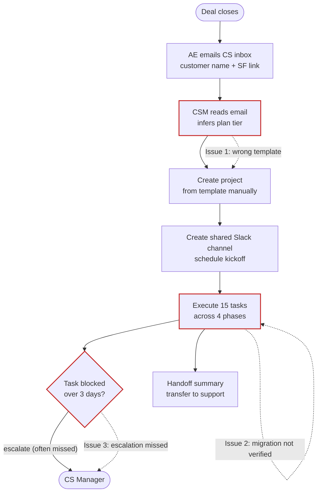
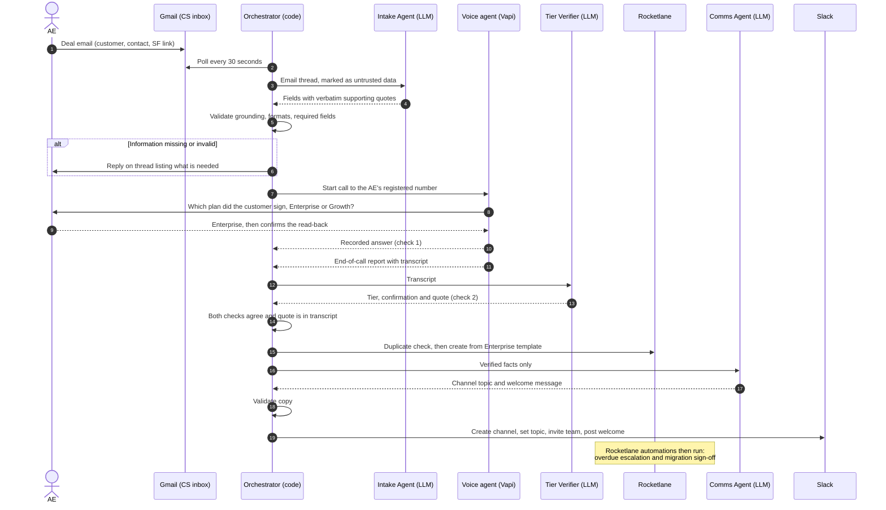
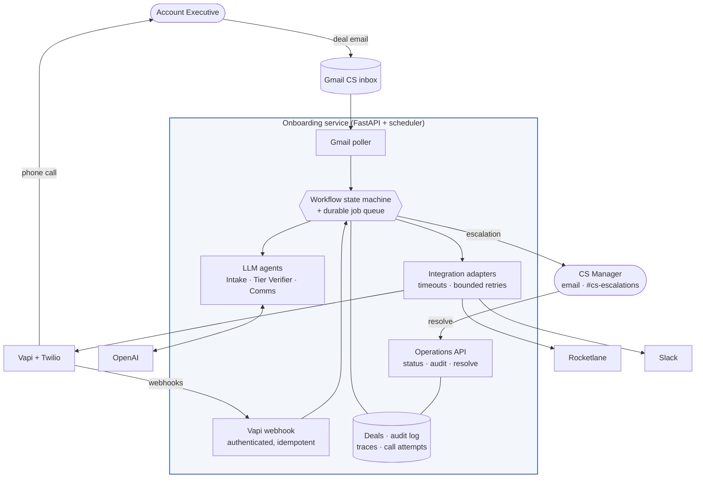
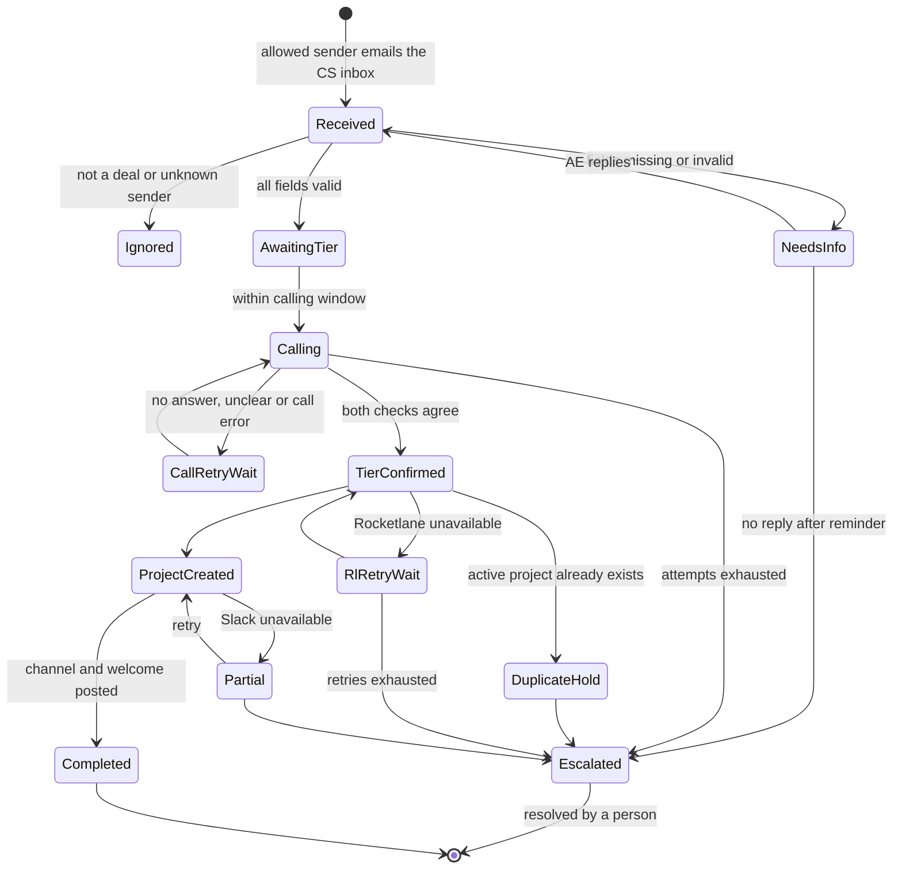

# Customer Onboarding Automation: Requirements & Workflow Analysis

| | |
|---|---|
| **Client** | NovaCRM, Customer Success |
| **Prepared for** | Rocketlane: Forward Deployed Engineer assessment (Part 1) |
| **Prepared by** | Karthick Sriram |
| **Date** | 29 October 2026 |
| **Version** | 1.0 |
| **Status** | Final. Design decisions confirmed with Karthik Ramaiah (Rocketlane), 29 Oct 2026 |

---

## 1. Executive summary

NovaCRM's Customer Success team onboards every new customer manually. An Account Executive (AE) emails the CS inbox when a deal closes; a CSM then creates a project from a template, opens a Slack channel, and tracks fifteen tasks across four phases. The process fails in three recurring ways:

1. **Template errors.** The email does not state the plan tier, so the CSM infers it and sometimes applies the wrong onboarding template.
2. **Unverified data migration.** Migration tasks can be marked complete without the customer confirming their data.
3. **Missed escalations.** Escalating stalled work depends on someone noticing it.

This document specifies a multi-agent system that automates the handoff from closed deal to active onboarding project:

- An **Intake & Routing Agent** reads and validates the deal email, and asks the AE for anything missing.
- A **voice agent** calls the AE to confirm the plan tier.
- The system **creates the Rocketlane project** from the correct template (Enterprise, 30 days; Growth, 14 days) and assigns the CSM.
- A **Communication Agent** opens a personalised Slack channel for the customer.
- **Rocketlane automations** escalate overdue tasks and request the customer's sign-off on migrated data.

**Guiding principle:** deterministic code controls the workflow. Language models are confined to reading and writing text, and never decide whether anything is created. When information is missing or uncertain, the system asks a person rather than guessing.

---

## 2. Current-state workflow

### 2.1 Process

| Step | Owner | Tool | Observed issue |
|---|---|---|---|
| Deal handoff | AE | Email | Unstructured text; plan tier absent; fields occasionally missing |
| Project creation | CSM | Asana | Template selected manually; Enterprise and Growth confused |
| Customer channel | CSM | Slack | Repetitive and inconsistent set-up |
| Phase checklists | CSM, customer | Asana | Migration can be closed without customer verification |
| Escalation | CSM | None | Relies on memory |
| Transfer to support | CSM | Document | Manual write-up |

### 2.2 Root-cause analysis

| Issue | Root cause | Remedy in the proposed system |
|---|---|---|
| Wrong template applied | The tier is not in the email, so it is inferred | Tier **confirmed by phone with a read-back**, checked independently against the call transcript, and **mapped to a template by fixed configuration**. No default tier exists. |
| Migration closed unverified | Completion is a single click with no customer step | "Customer verifies migrated data" is assigned to the customer and triggers a **formal approval request** in Rocketlane when completed. |
| Escalations missed | No system enforces them | **Rocketlane automation** notifies the Project Manager at 1 day overdue and the Project Owner at 4 days. |
| Slow, error-prone set-up | Manual transcription from email | Fields extracted by the Intake Agent **with supporting quotations**, then validated by code. |

---

## 3. Objectives and scope

**Objectives**

1. Every closed deal becomes a correctly templated Rocketlane project without manual entry.
2. No project is created on an unconfirmed or ambiguous plan tier.
3. Every customer receives a consistent, personalised Slack channel on day one.
4. Overdue work is escalated automatically, and migrated data is signed off by the customer.
5. Every automated action is traceable: what was done, when, with what input, and why.

**In scope:** Gmail-triggered intake; voice confirmation of the plan tier; Rocketlane project creation with CSM assignment; the personalised Slack channel; overdue-task escalation and migration sign-off in Rocketlane; guardrails; audit trail; automated tests.

**Out of scope for this phase** (see §11 roadmap): kickoff-call scheduling, the end-of-onboarding handoff summary, escalation of *blocked* tasks, Salesforce integration, and migration of existing Asana projects.

---

## 4. Proposed workflow

### 4.1 End-to-end sequence

### 4.2 Roles and responsibilities

| Component | Type | Input | Output | Constraint |
|---|---|---|---|---|
| **Intake & Routing Agent** | LLM, OpenAI Agents SDK, no tools | Email thread, wrapped as untrusted data | Customer, contact name and email, AE name, Salesforce link, each with a supporting quote; whether the email is a deal handoff | Cannot infer the tier, invent values, or trigger actions |
| **Voice agent** | Vapi assistant on a Twilio number | AE name, customer name | The AE's answer and explicit confirmation, via a single tool call | Records only; makes no decisions |
| **Tier Verifier** | LLM, no tools | Call transcript | Tier, confirmation flag, supporting quote | Must agree with the voice agent's record |
| **Orchestrator** | Deterministic state machine | Validated agent outputs | All external actions: calls, projects, channels, escalations | Acts only on validated data |
| **Communication Agent** | LLM, no tools | Verified facts only; never email text | Channel topic and welcome message | Output validated by code before posting |
| **Overdue escalation** | Rocketlane automation | Task due dates | Notifications to Project Manager and Project Owner | Configured in Rocketlane; no custom code |

---

## 5. Solution architecture

### 5.1 Component view

### 5.2 Design principles

1. **Deterministic control, LLMs at the edges.** A state machine governs every transition. Language models perform three bounded tasks: interpreting the email, verifying the transcript, and drafting Slack copy.
2. **Agents propose; code executes.** Each agent returns a typed, validated result and has no tools that change anything. Only code calls Rocketlane or Slack.
3. **Escalate rather than guess.** Missing data triggers a request to the AE; an unclear tier triggers a retry, then a human. There is no default tier.
4. **Resilient and idempotent.** Work runs as durable jobs that survive restarts. Each creation step is idempotent: a retry finds the existing record instead of duplicating it.
5. **Replaceable integrations.** Each external service sits behind a single interface, so tests use fakes and production changes are configuration.

### 5.3 Deal lifecycle

**Technology:** Python 3.12, FastAPI, OpenAI Agents SDK, Pydantic, SQLite (PostgreSQL in production), APScheduler with a persistent job store, Vapi with Twilio telephony, Rocketlane REST API, Slack Web API.

---

## 6. Requirements

### 6.1 Functional requirements

| ID | Requirement | Implementation |
|---|---|---|
| FR‑1 | Detect new deal emails in the CS inbox | Poll every 30 seconds; each message processed exactly once; only allow-listed senders accepted |
| FR‑2 | Extract customer name, contact name and email, AE name and Salesforce link | Intake Agent returns each field with a verbatim quote; code verifies both appear in the AE's text |
| FR‑3 | Do not proceed on incomplete or invalid data | Reply on the email thread naming the missing items; one reminder; then escalation |
| FR‑4 | Confirm the plan tier with the AE by phone | Voice agent calls the AE's registered number, asks for the tier, reads back customer and tier, and requires explicit confirmation |
| FR‑5 | Act only on an unambiguous tier | Two independent checks (voice record and transcript verification) must agree, and the supporting quote must appear in the transcript |
| FR‑6 | Create the project with the correct template and timeline | **Enterprise:** 30-day template, dedicated CSM assigned round-robin. **Growth:** 14-day template, pooled CSM. Mapping held in configuration. |
| FR‑7 | Prevent duplicate projects | A project carrying this deal's reference is adopted; an active project for the same customer holds the deal for review |
| FR‑8 | Create a personalised Slack channel | Channel `#onb-<customer>-<id>`; tier-specific topic and welcome naming the customer, tier and CSM; customer invited via Slack Connect |
| FR‑9 | Escalate overdue tasks | Rocketlane automation: 1 day overdue → Project Manager; 4 days → Project Owner |
| FR‑10 | Obtain customer sign-off on migrated data | Completing "Customer verifies migrated data" sends an approval request to the customer |
| FR‑11 | Support human intervention | Escalations by email and in `#cs-escalations`; an operations endpoint to confirm a tier, retry a step, re-read the email or dismiss, with the person and reason recorded |

### 6.2 Non-functional requirements

| Area | Requirement |
|---|---|
| **Auditability** | Every action records timestamp, actor, input, output and rationale. Agent runs are traced and grouped by deal. Both are available per deal through the operations API. |
| **Reliability** | Every external call has a timeout, bounded retries with back-off, and a defined failure outcome. Work survives restarts; a periodic sweep recovers interrupted work. |
| **Idempotency** | No duplicate deals, calls, projects, channels or messages, including when a request times out after succeeding. |
| **Security** | Webhooks authenticated before the payload is read; operations API protected by a token; secrets held only in environment configuration; email and transcript text treated as untrusted input. |
| **Calling etiquette** | Calls only within the AE's business hours (configurable window and time zone), maximum three attempts. |
| **Configurability** | Business rules (required fields, templates, CSM pools, retry intervals, calling window) are configuration, not code. |
| **Scale** | Sized for ~200 customers and a few deals per week. §11 sets out the changes for higher volume. |

---

## 7. Guardrails and exception handling

| Scenario | System behaviour |
|---|---|
| Email lacks customer name or contact email | Processing pauses; the AE is asked for the specific items; reminder after 24 hours; escalation after 48 hours |
| Extracted value not present in the email | Rejected: every value and its quote must appear in the AE's text |
| Non-deal email or unknown sender | Recorded and ignored; no call placed |
| AE does not answer | Retried after 10 and 30 minutes within the calling window; escalated after three attempts |
| Ambiguous answer | The voice agent asks once more; if still unclear, recorded as unclear (never mapped to a tier), retried, then escalated |
| Voice record and transcript disagree | Treated as unclear: retried, then escalated |
| Rocketlane unavailable | Retried after 1, 5 and 15 minutes, then escalated; success is never assumed |
| Request timed out but succeeded | The next attempt finds the project by its deal reference and adopts it; no duplicate |
| Customer already has an active onboarding project | Deal held and escalated; a second project is never created |
| Slack or the copy-writing model unavailable | Channel set-up resumes from the last completed step; a validated standard message replaces the generated copy |
| Any escalation | A person is notified with what happened, what was attempted and how to resolve it |

---

## 8. Rocketlane configuration

### 8.1 Templates

Both templates share four phases and fifteen tasks and differ in duration.

| Phase | Tasks |
|---|---|
| Kickoff | Review sales handoff · Kickoff call · Agree success criteria and plan |
| Data Migration | Provide data export · Field mapping sign-off · Sandbox import · **Customer verifies migrated data** · Production import |
| Configuration | Workspace and user setup · Pipelines and custom fields · Integrations · Admin training |
| Go-Live | UAT sign-off · Go-live · Handoff to support |

| | Enterprise | Growth |
|---|---|---|
| Template | Enterprise Onboarding (30d) | Growth Onboarding (14d) |
| CSM model | Dedicated CSM, assigned round-robin | Pooled onboarding team |
| Project Owner | CS Manager | CS Manager |

### 8.2 Automations

| Automation | Trigger | Action |
|---|---|---|
| Overdue task escalation | Task becomes overdue (onboarding templates only) | 1 day: notify the **Project Manager** (CSM). 4 days: notify the **Project Owner**. Each fires once per task. |
| Migration sign-off | "Customer verifies migrated data" marked Completed | Request approval from the **Customer** |

---

## 9. Decisions and assumptions

### 9.1 Confirmed decisions

Clarifying questions were sent to Karthik Ramaiah (karthikr@rocketlane.com) on 28 October 2026. On 29 October he confirmed the proposed approach for each. All six are implemented as configuration.

| # | Question | Decision |
|---|---|---|
| Q1 | What does a deal email contain: the customer contact email, the AE's phone? | The contact email is in the email body. The AE's phone comes from an AE directory, with the email as fallback. Required fields are configurable. |
| Q2 | How is the dedicated CSM chosen; who are the Project Manager and Owner? | Enterprise: dedicated CSM by round-robin from a pool. Growth: shared onboarding team. CSM is the Project Manager; the CS Manager is the Project Owner. |
| Q3 | Same tasks for both tiers, or different task lists? | Same fifteen tasks; different durations (30 and 14 days). |
| Q4 | Confirm the customer on the call? Retry limit and escalation route? | The call names the customer and the AE confirms the customer and tier together in the read-back. Three attempts, then escalation to the CS Manager. |
| Q5 | Escalate blocked tasks as well as overdue ones? | Overdue only, as specified. Blocked-task escalation is a roadmap item. |
| Q6 | Require customer sign-off on data migration? | Yes, through a Rocketlane approval on the verification task. |

### 9.2 Assumptions

1. Rocketlane replaces Asana for new onboardings; existing Asana projects are not migrated.
2. Only the Enterprise and Growth tiers exist; any other answer is treated as unclear.
3. The tier comes from the AE call, as specified; Salesforce is not queried.
4. AEs are called only during business hours (default Monday to Friday, 09:00 to 19:00 IST).
5. Slack Connect, which invites the customer into the channel, requires a paid Slack plan. In this implementation the invitation is logged rather than sent; the channel, topic and welcome message are live.

---

## 10. Verification

An automated suite of 449 offline tests (all external services replaced by fakes) runs with linting and strict type checking before every change.

| Assessment requirement | Coverage |
|---|---|
| Happy path | End-to-end test of every job through its real entry point: email → intake → call → webhooks → tier decision → Enterprise project → personalised channel → completed |
| Validation | Missing customer name or contact email, values absent from the email, invalid formats, non-deal emails, unknown senders |
| Template accuracy | Enterprise → 30-day template with dedicated CSM; Growth → 14-day template with pooled CSM |
| Edge cases | Rocketlane unavailable; existing project; timed-out creation adopted without duplication; unanswered call; ambiguous answer; disagreement between checks; Slack unavailable; repeated webhooks |

Each component was also verified against the live services: Gmail intake, a real phone call confirming the tier, project creation in Rocketlane from the correct template, and the personalised Slack channel.

---

## 11. Production readiness and roadmap

### 11.1 Changes for production

| Area | Current implementation | Production approach |
|---|---|---|
| Slack Connect | Customer invitation logged (paid feature) | Enable on a paid workspace; single configuration flag |
| Telephony | Twilio trial (trial notice precedes each call) | Paid Twilio account with a local number for the AE's country |
| Email trigger | Polling every 30 seconds | Gmail push notifications via Pub/Sub |
| Data store | SQLite, single instance | PostgreSQL, multiple instances; no code change |
| Secrets | Environment file | Secrets manager with key rotation |
| Monitoring | Health endpoint, logs, traces | Alerting on escalations and failed jobs; operations dashboard |

### 11.2 Roadmap

1. **Blocked-task escalation:** a Rocketlane automation on tasks blocked for more than three days.
2. **Kickoff scheduling:** propose meeting times from the CSM's calendar in the welcome message.
3. **Handoff summary:** at Go-Live, generate a summary from project and channel history for the support team.
4. **Salesforce integration:** pre-fill the tier from the opportunity, retaining the call as confirmation.
5. **Continuous improvement:** analyse escalation reasons to improve the AE handoff format.
