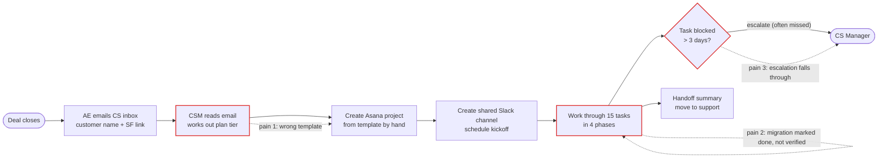
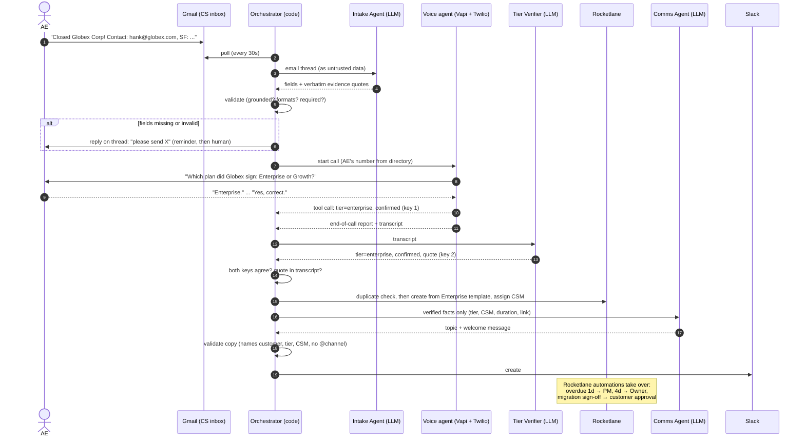
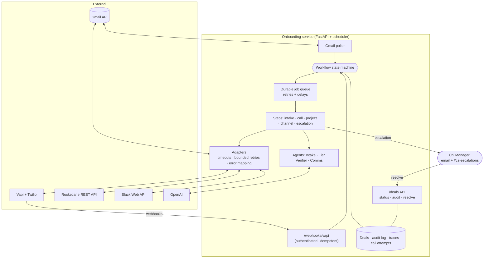
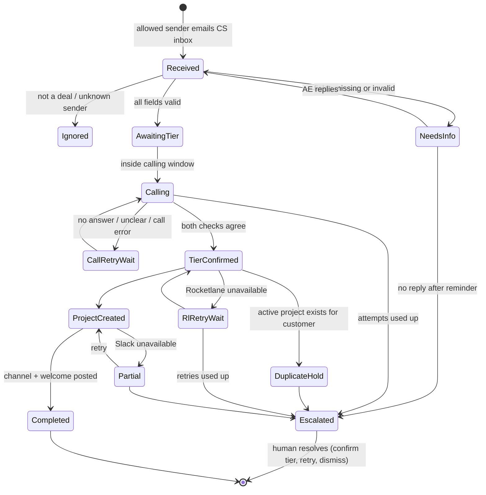

# NovaCRM Customer Onboarding Automation: Requirements & Workflow Analysis

**Part 1 deliverable**, Rocketlane Forward Deployed Engineer take-home
Author: Karthick Sriram · 29 Oct 2026

---

## 1. Summary

NovaCRM's Customer Success team onboards every new customer by hand. An AE emails the CS inbox, someone creates a project from a template, opens a Slack channel, and follows up on tasks from memory. The process breaks in three predictable places: the **wrong template** gets picked, **data migration is marked done without the customer checking it**, and **overdue or blocked work isn't escalated**.

The proposed system automates the handoff from closed deal to a running onboarding project:

1. An **Intake & Routing Agent** reads the deal email, validates it, and asks the AE for anything missing.
2. A **voice agent** calls the AE to confirm the plan tier, which is never in the email.
3. **Code** creates the Rocketlane project from the right template (Enterprise 30-day or Growth 14-day) and assigns the CSM.
4. A **Communication Agent** opens a personalized Slack channel for the customer.
5. **Rocketlane automations** escalate overdue tasks and collect the customer's sign-off on migrated data.

The design rule throughout: **deterministic code runs the workflow; LLMs are used only for reading and writing language, and never make a decision that creates something.** When the system is unsure, it asks a person instead of guessing.

---

## 2. Current workflow (as-is)

| Step | Who | Tool | Problem |
|---|---|---|---|
| Deal handoff | AE | Email | Free text. The plan tier isn't included; fields are sometimes missing. |
| Project creation | CSM | Asana | Template chosen by hand; Enterprise and Growth templates get mixed up. |
| Customer channel | CSM | Slack | Repetitive and inconsistent. |
| Phase checklists | CSM + customer | Asana | "Data migrated" can be ticked without the customer verifying anything. |
| Escalation | CSM | Memory | "Blocked > 3 days" relies on someone noticing. |
| Handoff to support | CSM | Doc | Manual write-up. |

### Root causes

| Pain point | Root cause | Fix in the proposed system |
|---|---|---|
| Template mix-ups | The tier isn't in the email, so a person infers it | The tier is **confirmed by phone with a read-back**, checked independently against the transcript, and **mapped to a template in code**. No default tier exists. |
| Unverified migration | "Done" is one click with no customer step | The task "Customer verifies migrated data" is assigned to the customer and triggers a **Rocketlane approval request** to the customer when completed. |
| Missed escalations | Depends on memory | A **Rocketlane automation** notifies the Project Manager at 1 day overdue and the Project Owner at 4 days. |
| Slow, error-prone setup | Manual copy-paste from email | Intake Agent extracts fields with **evidence quotes**; code validates them. |

---

## 3. Scope

**In scope:** the Gmail-triggered intake, the voice confirmation of the tier, Rocketlane project creation from the right template with CSM assignment, the personalized Slack channel, both Rocketlane automations, guardrails, a full audit trail, and automated tests.

**Out of scope for this phase** (listed as follow-ups in §11): kickoff-call scheduling, the end-of-onboarding handoff summary, escalating *blocked* (as opposed to overdue) tasks, reading Salesforce, and migrating existing Asana projects.

---

## 4. Proposed agentic workflow (to-be)

### Agents and responsibilities

| Component | Type | Input | Output | Cannot do |
|---|---|---|---|---|
| **Intake & Routing Agent** | LLM (OpenAI Agents SDK), no tools | Email thread, wrapped as untrusted data | Customer, contact name/email, AE name, SF link, each with an exact quote; "is this a deal handoff?" | Infer the tier, invent a value, or trigger anything |
| **Voice agent** | Vapi assistant on a Twilio number | AE name, customer name | The AE's tier answer and confirmation, via one tool call | Decide; it only records what the AE said |
| **Tier Verifier** | LLM, no tools | Call transcript | Tier, whether the AE confirmed, a supporting quote | Override the voice result; both must agree |
| **Orchestrator** | Deterministic code (state machine) | Validated agent outputs | Every external action: calls, project, channel, escalations | Proceed on anything unvalidated |
| **Communication Agent** | LLM, no tools | Verified facts only, no email text | Channel topic and welcome message | Post anything without code validating it first |
| **Overdue escalation** | Rocketlane automation (configured in Rocketlane) | Task due dates | Notifications to PM (1 day) and Owner (4 days) | n/a: no code involved |

---

## 5. Architecture

### Design principles

1. **Deterministic spine, LLM at the edges.** A state machine owns every transition. LLMs only parse the email, check the transcript, and write Slack copy.
2. **Agents propose, code executes.** Each agent returns a typed, validated object and has no tools that change anything. Only code calls Rocketlane or Slack.
3. **Fail to a human, never to a guess.** Missing data means asking; an unclear tier means retrying, then escalating. There is no default tier.
4. **Every step survives a crash.** Work runs as durable jobs. Every create is idempotent: the Gmail message id, a marker on the Rocketlane project, and a deterministic Slack channel name mean a retry finds what already exists instead of duplicating it.
5. **Integrations behind interfaces.** Each external service has an adapter behind one interface, so tests swap in fakes and a production change (e.g. Slack Connect) is a config switch.

### Deal lifecycle

**Stack:** Python 3.12, FastAPI, OpenAI Agents SDK, Pydantic, SQLite (Postgres in production), APScheduler with a persistent job store, Vapi with a Twilio number, Rocketlane REST API, Slack Web API.

---

## 6. Functional requirements

| ID | Requirement | How it's met |
|---|---|---|
| FR1 | Detect new deal emails in the CS Gmail inbox | Poller every 30s; each message processed once (keyed by Gmail id); only allow-listed senders |
| FR2 | Extract customer name, contact name and email, AE name, Salesforce link | Intake Agent returns each field **with a verbatim quote**; code checks the quote and value appear in the AE's own words |
| FR3 | Never proceed with missing or invalid data | Missing or invalid fields → reply on the thread naming exactly what's needed; one reminder; then a human |
| FR4 | Confirm the plan tier by phone with the AE | Vapi voice agent calls the AE's number from the AE directory, asks the tier, reads it back, and requires an explicit "yes" |
| FR5 | Only act on an unambiguous tier | **Two keys:** the voice agent's recorded answer and an independent transcript check must agree, with the supporting quote found in the transcript |
| FR6 | Create the Rocketlane project with the right template and timeline | Tier → template in config: **Enterprise = 30-day template, dedicated CSM (round-robin)**; **Growth = 14-day template, pooled CSM** |
| FR7 | Don't create duplicate projects | Before creating: an existing project with our marker is adopted; an active project for the same customer holds the deal for a human |
| FR8 | Create a personalized Slack channel | `#onb-<customer>-<id>`; topic and welcome written per tier and customer; the customer contact is invited via Slack Connect |
| FR9 | Escalate overdue tasks | Rocketlane automation: overdue 1 day → Project Manager; 4 days → Project Owner |
| FR10 | Verify migrated data with the customer | Completing "Customer verifies migrated data" sends the customer an approval request in Rocketlane |
| FR11 | Let a human take over | Escalations go by email and to `#cs-escalations`; `POST /deals/{id}/resolve` to confirm a tier, retry a step, re-read the email, or dismiss, recording who and why |

## 7. Non-functional requirements

| Area | Requirement |
|---|---|
| **Auditability** | Every action is logged with timestamp, actor, input, output and decision rationale; each agent run is traced and grouped by deal. Both are viewable per deal through the API. |
| **Reliability** | Every external call has a timeout, bounded retries with backoff, and a defined failure state. Work survives restarts; a periodic sweep re-queues anything stranded. |
| **Idempotency** | No duplicate deals, calls, projects, channels or welcome messages, even when a request times out after succeeding. |
| **Security** | Webhooks authenticated with a shared secret before the body is read; admin API behind a token; secrets only in environment variables; email and transcript text treated as untrusted (prompt-injection resistant). |
| **Respectful calling** | Calls only in the AE's business hours (configurable window and timezone); max 3 attempts. |
| **Changeability** | Every business rule (required fields, templates, CSM pools, retry delays, calling window) is configuration, not code. |
| **Scale** | ~200 customers total and a few deals a week: one service with polling is sufficient. §10 lists what changes at higher volume. |

---

## 8. Guardrails and failure handling

| Situation | System behaviour |
|---|---|
| Email missing the customer name or contact email | Not processed further. The AE gets a reply listing exactly what's missing; reminder after 24h; escalated after 48h. |
| Value the LLM "found" that isn't in the email | Rejected by grounding: the value and its quote must appear in the AE's text. |
| Email isn't a deal handoff / unknown sender | Recorded and ignored; no call is placed. |
| AE doesn't answer | Retried after 10 min, then 30 min, within the calling window; after 3 attempts → human. |
| Ambiguous answer ("probably the bigger one") | The voice agent re-asks once; if still unclear, it's recorded as *unclear*, never mapped to a tier. Retry, then human. |
| Voice result and transcript disagree | Treated as unclear: retry, then human. |
| Rocketlane API down | Retried at +1, +5, +15 min; then escalated. Success is never assumed. |
| Create timed out but actually succeeded | The next attempt finds the project by our marker and adopts it: one project, no duplicate. |
| Customer already has an active onboarding project | Deal held and escalated; a second project is never created. |
| Slack down or the LLM unavailable for copy | Channel steps resume where they stopped; a validated fixed template replaces the agent's copy. The LLM can never block the channel. |
| Any escalation | A person is notified with what happened, what was tried, and how to resolve it. |

---

## 9. Rocketlane configuration

**Templates:** two templates with the same 4 phases and 15 tasks, differing in duration.

| Phase | Tasks |
|---|---|
| Kickoff | Review sales handoff · Kickoff call · Agree success criteria & plan |
| Data Migration | Provide data export · Field mapping sign-off · Sandbox import · **Customer verifies migrated data** · Production import |
| Configuration | Workspace & user setup · Pipelines & custom fields · Integrations · Admin training |
| Go-Live | UAT sign-off · Go-live · Handoff to support |

| | Enterprise | Growth |
|---|---|---|
| Template | Enterprise Onboarding (30d) | Growth Onboarding (14d) |
| CSM | Dedicated, assigned round-robin from a pool | Pooled onboarding pod |
| Project Owner | CS Manager | CS Manager |

**Automations** (configured in Rocketlane, not in code):

- **Overdue task escalation:** trigger *task becomes overdue*. Overdue by 1 day → notify the **Project Manager** (the CSM role). Overdue by 4 days → notify the **Project Owner**. Limited to projects from the two onboarding templates. Each notification fires once per task.
- **Migration sign-off:** when "Customer verifies migrated data" is marked Completed, request approval from the **Customer** role.

---

## 10. Clarifying questions and assumptions

Questions were sent to karthikr@rocketlane.com on 28 Oct 2026. No answers had been received when this was written, so each default below is built in **as configuration**. Changing one is a config edit, not a code change.

| # | Question | Assumption used |
|---|---|---|
| Q1 | What does a real deal email contain? Does it include the contact email and the AE's phone? | Contact email is in the body; the AE phone comes from an AE directory (with the email as a fallback). Required fields are configurable. |
| Q2 | How is the dedicated CSM chosen, and who are the Project Manager and Owner? | Dedicated CSM by round-robin from a pool; Growth uses a shared pod user. CSM = Project Manager; CS Manager = Project Owner. |
| Q3 | Same ~15 tasks for both tiers, or different task lists? | Same tasks, different durations (30 vs 14 days). |
| Q4 | Confirm the customer name on the call too? Retry limit and escalation target? | The call names the customer and confirms the AE's identity; 3 attempts; escalate to the CS Manager. |
| Q5 | Also escalate *blocked* tasks (Priya's "blocked > 3 days"), or only overdue? | Overdue only, as the brief specifies. Blocked-task escalation is a follow-up. |
| Q6 | Should migration require customer sign-off? | Yes: customer approval on the verification task. |

**Further assumptions:**

1. Rocketlane replaces Asana for new onboardings; existing Asana projects aren't migrated.
2. Only two tiers exist; any other answer counts as unclear.
3. The tier comes from the AE call, per the brief; Salesforce isn't read.
4. AEs are only called during business hours (default Mon–Fri, 09:00–19:00 IST).
5. Inviting the customer into the Slack channel uses Slack Connect, a paid feature. In this build that invite is logged rather than sent; the channel, topic and welcome are real.

---

## 11. Testing strategy

An offline test suite (449 tests, no external calls, fakes for every integration) runs before every change, alongside lint and strict type checks.

| Brief requirement | Covered by |
|---|---|
| Happy path | One end-to-end test runs every job through its real entry point: email → intake → call → webhooks → two-key tier decision → Enterprise project → personalized Slack channel → completed |
| Validation | Missing customer name or contact email, invented values not in the email, wrong formats, non-deal emails, unknown senders |
| Template accuracy | Enterprise → 30-day template with dedicated CSM; Growth → 14-day template with pooled CSM |
| Edge cases | Rocketlane down (retry then escalate), existing project (hold and escalate), timed-out create (adopted, not duplicated), no answer (retry in window), ambiguous answer, voice/transcript disagreement, Slack down, replayed webhooks |

Each piece was also run live: Gmail, the Intake Agent, a real phone call with tier confirmation, project creation in Rocketlane, and the Slack channel.

---

## 12. Production considerations and next steps

| Area | This build | In production |
|---|---|---|
| Slack Connect | Customer invite logged (paid feature) | Enable Slack Connect on a paid workspace; one config flag |
| Telephony | Twilio trial (plays a trial notice before the call) | Paid Twilio account and a local number for the AE's country |
| Inbox trigger | Polling every 30s | Gmail push notifications (Pub/Sub) |
| Database | SQLite, single instance | Postgres with the same code; run more than one instance |
| Secrets | `.env` file | A secrets manager, with key rotation |
| Monitoring | Health endpoint, logs, traces | Alerts on escalations and failed jobs, plus a dashboard |

**Follow-ups beyond this phase:**

1. **Blocked-task escalation** (Priya's "blocked > 3 days"): a Rocketlane automation on status *Blocked*.
2. **Kickoff scheduling:** propose times from the CSM's calendar in the welcome message.
3. **Handoff summary:** at Go-Live, generate a summary from the project and channel history for the support team.
4. **Salesforce:** read the tier from the opportunity, keeping the call only to confirm it.
5. **Feedback loop:** use escalation reasons to improve the email format AEs send.
